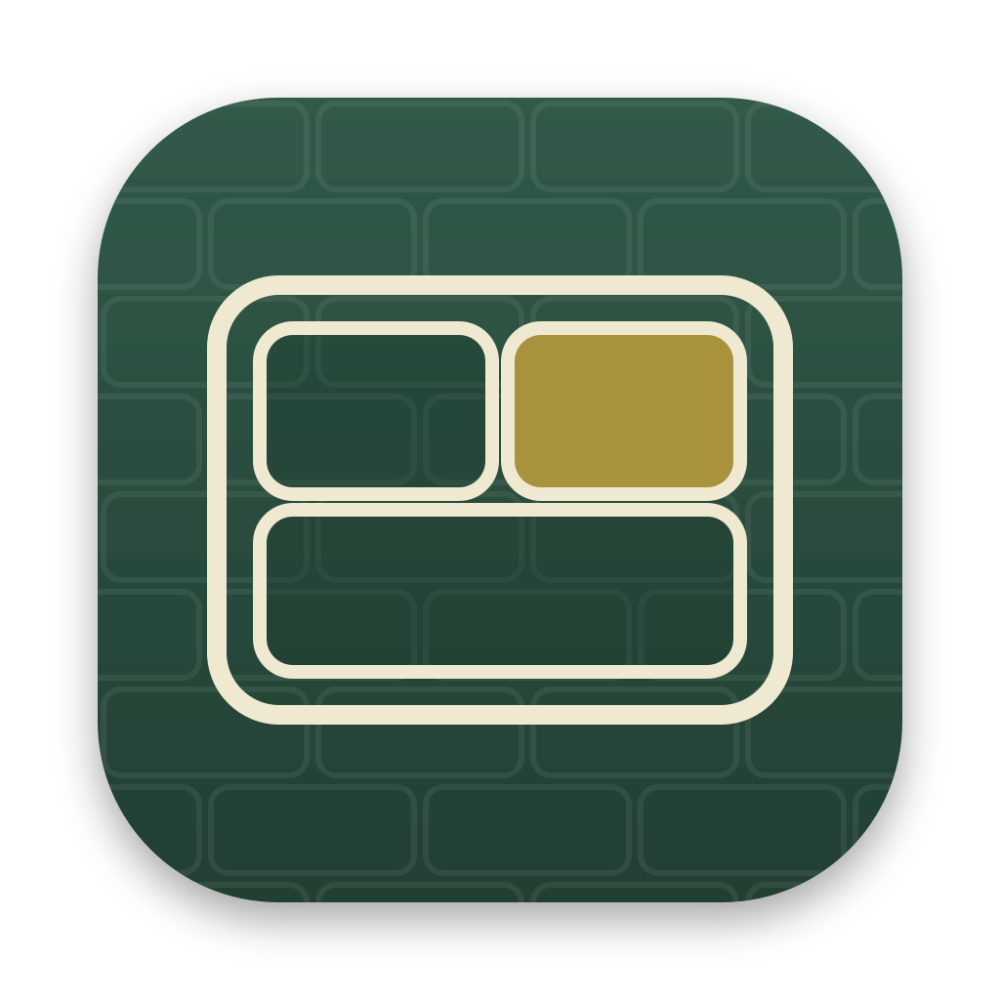
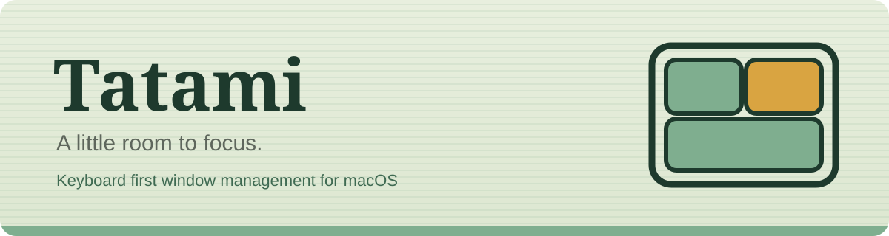
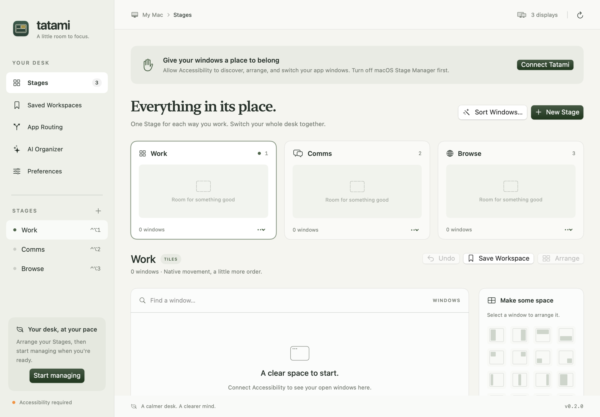
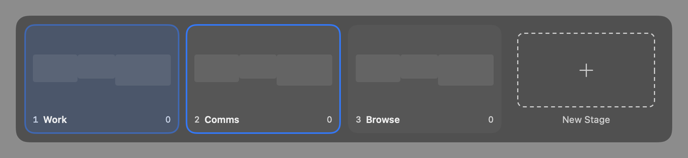
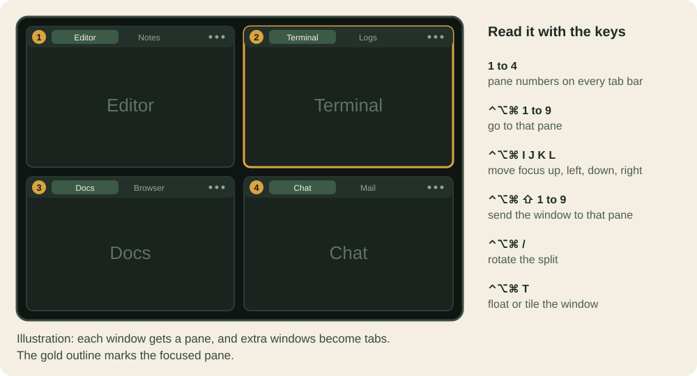
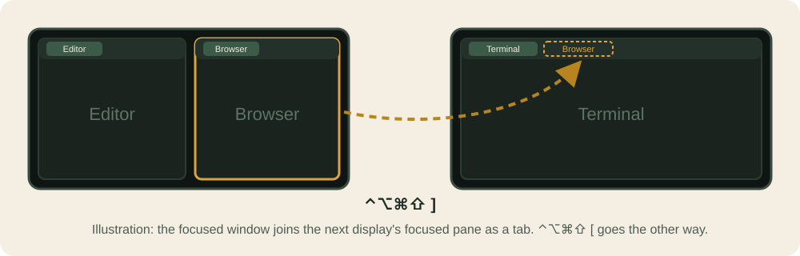
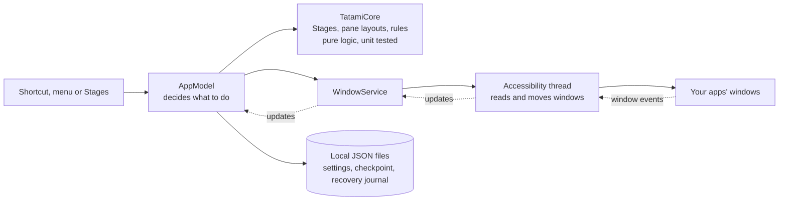
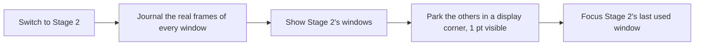

<p align="center">
  
</p>

<p align="center">
  
</p>

<p align="center">
  
  
  
  
  
  
</p>

<p align="center">
  <a href="#why-tatami">Why</a> ·
  <a href="#see-it">See it</a> ·
  <a href="#quick-start">Quick start</a> ·
  <a href="#how-it-works">How it works</a> ·
  <a href="#keyboard-cheat-sheet">Keys</a> ·
  <a href="#features">Features</a> ·
  <a href="#safety-and-privacy">Safety</a> ·
  <a href="#project-layout">Project</a>
</p>

# Tatami

A native macOS workspace manager that you drive from the keyboard, like AeroSpace. Give each task a **Stage**, let your windows tile themselves into **Tiles**, and move between everything with one key. The mouse works too, but nothing needs it.

> **Alpha (0.3.0).** Tatami works day to day on the setups it was built on, but expect rough edges: multi-display and unusual apps are the least tested, and settings or shortcuts may still change between releases. It moves other apps' windows off screen to switch Stages, so read [Safety and privacy](#safety-and-privacy) first, and keep `⌃⌥⌘R` (rescue) in mind. Bug reports are very welcome.

## Why Tatami

| | |
|---|---|
| **Stages** | Group the windows of one task across every display. Switch tasks instantly with `⌃⌥1` to `⌃⌥9`. |
| **Tiles** | New windows join a pane on their own. Panes have tab bars and numbers, and every move has a key. |
| **Keyboard first** | Focus, move, swap, rotate, float, send to another display: all on keys, with the mouse as an optional extra. |
| **Safe by design** | Real window positions are journaled before anything is hidden. Quit, crash or pause and your windows come back. |
| **Local first** | No account, no telemetry. The only network traffic is an AI request you start, to the provider you chose. |

## See it

The first two images are real captures of the Tatami app, taken with a clean data folder. The last two are drawn illustrations, because real ones would show your own windows.

**The dashboard**

<p align="center"></p>

| Control | Keys |
|---|---|
| Switch to Stage 1 to 9 | `⌃⌥1` to `⌃⌥9` |
| New or close Stage | `⌃⌥N` / `⌃⌥X` |
| Arrange the active Stage | `⌃⌥⌘↓` |
| AI Organizer | `⌃⌥Z` |

**Stages: one card per task, across every display** (rest the pointer at the top centre of a screen, or press `⌃⌥⌘↑`)

<p align="center"></p>

| Control | Keys |
|---|---|
| Show the cards | `⌃⌥⌘↑` |
| Pick a card | click it, or `←` `→` then `Return`, or press `1` to `9` |
| Rename, close, reorder | click the name, hover for ×, drag a card |
| Move a window to a Stage | drag it to a card, or `⌃⌥⇧1` to `⌃⌥⇧9` |

**Tiles: every window gets a pane, with a number on its tab bar** (illustration)

<p align="center"></p>

| Control | Keys |
|---|---|
| Focus the pane up, left, down, right | `⌃⌥⌘ I J K L` |
| Go to pane 1 to 9 | `⌃⌥⌘1` to `⌃⌥⌘9` |
| Move the window to pane 1 to 9 | `⌃⌥⌘⇧1` to `⌃⌥⌘⇧9` |
| Rotate the split | `⌃⌥⌘/` |
| Float or tile the window | `⌃⌥⌘T` |

**Send a window to another display** (illustration)

<p align="center"></p>

| Control | Keys |
|---|---|
| Send the window to the next or previous display | `⌃⌥⌘⇧]` / `⌃⌥⌘⇧[` |
| Same, from a terminal | `tatami display next` |

## Quick start

Requires macOS 14 or later and the Xcode command-line tools (Swift 5.10 or later). No external dependencies.

```sh
swift test
bash scripts/package_app.sh
open dist/Tatami.app
```

Then, in the app:

1. Choose **Connect Tatami** and enable it under System Settings → Privacy & Security → Accessibility. Turn off Apple's Stage Manager.
2. Create or rename Stages, or use **Sort Windows into Stages…** in the menu bar to group chat apps, browsers and everything else (you confirm a preview first).
3. Choose **Start managing**. Windows tile on their own and `⌃⌥1` to `⌃⌥9` switch Stages.
4. Close the dashboard to keep using the menu-bar app. Quitting restores every window Tatami hid.

> If you use AeroSpace, yabai or Amethyst, quit it first: two managers fight over the same windows.

<details>
<summary><b>Signing, Xcode and build problems</b></summary>

- To sign with a stable identity (needed so Keychain-stored AI keys and the Accessibility permission survive rebuilds), list identities with `security find-identity -v -p codesigning` and run `TATAMI_SIGN_IDENTITY="Apple Development: …" bash scripts/package_app.sh`. Without it the app is ad-hoc signed and you must re-grant Accessibility after each rebuild.
- The package also opens directly in Xcode through `Package.swift`.
- If the project lives in `~/Documents` or another iCloud or Finder-tagged folder, `swift test` may fail with "resource fork, Finder information, or similar detritus not allowed". Build outside it: `swift test --scratch-path /tmp/tatami-build`.
- Distribution needs your own Developer ID signing and notarization.

</details>

## How it works

Tatami is a small native app. Everything that decides *what should happen* is pure, unit-tested logic. A single Accessibility thread does the touching.



**When a new window appears**

```mermaid
flowchart TD
    N["New window appears"] --> S{"Standard window?"}
    S -- no --> I["Ignored: dialogs and popups are left alone"]
    S -- yes --> F{"Floats by default or by a rule?"}
    F -- yes --> L["Floats above the tiles"]
    F -- no --> T{"Display in Tiles?"}
    T -- no --> Q["Stays where the app put it"]
    T -- yes --> P["Joins a pane: its own pane up to four, then a tab"]
    P --> O{"Fits its pane?"}
    O -- yes --> D["Done"]
    O -- no --> G{"Room to grow the pane?"}
    G -- yes --> W["Pane grows, neighbours give way"]
    G -- no --> L
```



<details>
<summary><b>What happens when you switch Stage</b></summary>



Switching is instant because nothing is animated: windows of the other Stages are moved just off screen, with one point left visible because macOS pulls fully hidden windows back. If an app refuses to move off screen, that window is minimized instead.

</details>

<details>
<summary><b>Under the hood</b></summary>

- **One Accessibility thread** owns every call into other apps. Slow apps cannot freeze the interface, and a window that does not answer in time is treated as unknown, never as gone.
- **Event driven.** Window events arrive through per-app observers. A short safety rescan runs in the background, and again after wake, display changes and Stage switches.
- **Stable identities.** Displays are identified by hardware (vendor, model, serial), not port. Windows are matched by window number, then by app and title.
- **Pure core.** Stage rules, the pane tree, focus by position, display order and window routing live in `TatamiCore`, with unit tests that need no screen or permissions.

</details>

## Keyboard cheat sheet

Global shortcuts work only while Tatami is managing. `⌃` Control, `⌥` Option, `⌘` Command, `⇧` Shift. The default **Standard** set avoids plain Option because Option alone types characters and moves by word. **Classic** (Preferences) uses `⌥` for Stages and `⌘⌥` in place of `⌃⌥⌘`.

| You want | Keys |
|---|---|
| Switch to Stage 1 to 9 | `⌃⌥1` to `⌃⌥9` |
| Send the focused window to Stage 1 to 9 | `⌃⌥⇧1` to `⌃⌥⇧9` |
| See every Stage as cards | `⌃⌥⌘↑`, or rest the pointer at the top centre |
| Focus the window or pane up, left, down, right | `⌃⌥⌘ I J K L` |
| Move or swap the window that way | add `⇧` |
| Go to pane 1 to 9 (numbers are on the tab bars) | `⌃⌥⌘1` to `⌃⌥⌘9` |
| Float or tile the focused window | `⌃⌥⌘T` (add `⇧` for its whole app) |
| Rotate a split, side by side or stacked | `⌃⌥⌘/` |
| Next or previous window, across displays | `⌃⌥⌘]` and `⌃⌥⌘[` |
| Send a window to the next or previous display | `⌃⌥⌘⇧]` and `⌃⌥⌘⇧[` |
| Switch a display between Tiles and Freeform | `⌃⌥B` |
| Undo a layout change | `⌃⌥⌘Z` |
| Rescue every hidden window | `⌃⌥⌘R` |

<details>
<summary><b>Every shortcut, Standard and Classic</b></summary>

| Action | Standard | Classic |
|---|---|---|
| Switch Stage | `⌃⌥1` to `⌃⌥9` | `⌥1` to `⌥9` |
| Send focused window to a Stage | `⌃⌥⇧1` to `⌃⌥⇧9` | `⌥⇧1` to `⌥⇧9` |
| Previous or next Stage | `⌃⌥⌘←` / `⌃⌥⌘→` | `⌥←` / `⌥→` |
| Cycle Stages (`⇧` reverses) | `⌃⌥Tab` | `⌥Tab` |
| Switch by scrolling | `⌃⌥` + scroll | `⌥` + scroll |
| Show Stages | `⌃⌥⌘↑` | `⌥↑` |
| New or close Stage | `⌃⌥N` / `⌃⌥X` | `⌥N` / `⌥X` |
| Merge all Stages | `⌃⌥M` | `⌥M` |
| Tiles or Freeform on the focused display | `⌃⌥B` | `⌥B` |
| Focus the pane or window up, left, down, right | `⌃⌥⌘ I J K L` | `⌘⌥ I J K L` |
| Move to that pane, or swap with the freeform window there | add `⇧` | add `⇧` |
| Focus the previous or next window, across displays | `⌃⌥⌘[` / `⌃⌥⌘]` | `⌘⌥[` / `⌘⌥]` |
| Previous or next tab | `⌃⌥[` / `⌃⌥]` | same |
| Split right or below | `⌃⌥⌘\` / `⌃⌥⌘⇧\` | `⌘⌥\` / `⌘⌥⇧\` |
| Float or tile the window, or its whole app | `⌃⌥⌘T` / `⌃⌥⌘⇧T` | `⌘⌥T` / `⌘⌥⇧T` |
| Rotate the split | `⌃⌥⌘/` | `⌘⌥/` |
| Focus pane 1 to 9 | `⌃⌥⌘1` to `⌃⌥⌘9` | `⌘⌥1` to `⌘⌥9` |
| Move the window to pane 1 to 9 | add `⇧` | add `⇧` |
| Send window to the previous or next display | `⌃⌥⌘⇧[` / `⌃⌥⌘⇧]` | `⌘⌥⇧[` / `⌘⌥⇧]` |
| Grow or shrink the pane | `⌃⌥⌘=` / `⌃⌥⌘−` | `⌘⌥=` / `⌘⌥−` |
| Zoom pane, Reflow as Grid, Layout undo, Raise Floats | `⌃⌥⌘ Return / G / Z / F` | `⌘⌥ Return / G / Z / F` |
| Arrange the active Stage | `⌃⌥⌘↓` | `⌥↓` |
| Snap halves | `⌃⌥` + arrows | same |
| Snap quarters | `⌃⌥ U / I / J / K` | same |
| Snap thirds | `⌃⌥ A / S / D` | same |
| Snap two thirds | `⌃⌥ Q / R / W` | same |
| Center or maximize | `⌃⌥ C` / `⌃⌥ Return` | same |
| AI Organizer | `⌃⌥Z` | same |
| Rescue and pause | `⌃⌥⌘R` | same |

Select a window row in the dashboard to use its snap controls. Classic shortcuts are global grabs and can shadow shortcuts of other apps while Tatami is managing.

</details>

## Features

<details open>
<summary><b>Stages</b></summary>

- Up to nine named Stages that span every display. Create, rename, reorder, remove, switch, send windows, merge all, and undo.
- Focusing a window from another Stage (Cmd+Tab, Dock) switches to it; returning to a Stage focuses its last used window.
- **Stage cards:** rest the pointer at the top centre of any screen to see every Stage as a card with a scaled map of your displays. Click to switch, click a name to rename, hover to close, drag cards to reorder, or drag a window to the top edge and drop it on a card (or **+** for a new Stage).
- **Sort Windows into Stages…** groups chat apps, browsers and the rest as a preview you confirm.
- Runs from the menu bar without a Dock icon (turn on **Show in Dock** in Preferences).

</details>

<details open>
<summary><b>Tiles</b></summary>

- **On by default.** With management running, every display tiles itself. **Tile new windows automatically** in Preferences changes the default, and `⌃⌥B` switches one display.
- Each window gets a pane (up to four; more windows become tabs). Each pane has a numbered tab bar: click a tab, right-click for Close, Split, Float, Move to Stage or **Move to Display**, and use the `⋯` menu for Split, Rotate, Zoom, Even Out, Reflow as Grid, Undo or Close Pane.
- Background tabs are parked like inactive Stages, so Cmd+Tab to one simply selects it.
- Drag a tiled window's edge to resize; only its neighbours change.
- **Float or tile** the focused window or its whole app with one key. System Settings, Calculator, Photo Booth and similar windows float by default.
- A window that cannot shrink to its pane makes the pane grow at its neighbours' expense; if there is no room, it floats instead of overlapping them.
- Layout undo keeps 20 steps per display.

</details>

<details>
<summary><b>Windows and displays</b></summary>

- Sixteen snap zones (halves, quarters, thirds, two thirds, centre, maximize) with per-display grid arrangement, spacing preference and geometry undo.
- Focus, swap and cycle windows by position across displays, in freeform and in Tiles.
- Send a window to the previous or next display from a tab menu or a shortcut. A tiled display takes it as a tab in its focused pane; a freeform display keeps its relative position and size.
- Display unplug and replug: windows from a disconnected display move to the one under the pointer, with a **Restore / Keep Current** prompt when it returns.

</details>

<details>
<summary><b>Rules, routing and saved arrangements</b></summary>

- Ordered app and title routing rules send new windows to a Stage. Always-visible exclusions keep apps such as a music player on every Stage.
- Per-app float or tile rules, with title-specific rules winning over app-wide ones.
- Save, preview, rename, delete and load arrangements of the windows that are open.
- Validated settings backup and import.

</details>

<details>
<summary><b>AI Organizer</b></summary>

Open it with `⌃⌥Z`, from the menu bar (**Arrange with AI…**), or from the dashboard. Describe the desk you want, review the proposed plan, and apply it as one undoable step.

- **Providers:** your own key for Anthropic, OpenAI, Gemini, DeepSeek, OpenRouter or any OpenAI-compatible endpoint, or a local model through Ollama or LM Studio. Keys live in your Keychain.
- **What it can do:** create and rename Stages, move windows between Stages, snap windows into zones on any display. It cannot delete Stages, change rules or preferences, or open and close apps. Every action is validated against your open windows, and invalid ones are listed with the reason.
- **What is sent:** app names, bundle IDs, window positions, Stage names, display sizes and, unless you turn it off per provider, window titles. Before the first cloud request Tatami shows the destination host and asks. Requests go directly to the provider, redirects are refused, and local presets never leave this Mac.

</details>

## Command line

`tatami stage 2`, `tatami focus left`, `tatami list windows --json` and more run the same actions as the shortcuts, from a terminal or script, over a private same-user socket. See [docs/command-line.md](docs/command-line.md) for the commands, exit codes and security notes.

## Safety and privacy

- **Real window positions are journaled before any window is hidden.** Quit, `killall Tatami`, a crash, or the next launch after one all put windows back.
- **Rescue Windows** (`⌃⌥⌘R`, or in the menu bar) pauses management and returns every window to a visible place.
- If Accessibility is revoked while windows are parked, they return automatically once access is granted again. Meanwhile **Window → Fill** (macOS 15 and later) in an app's menu brings a window back.
- Data lives under `~/Library/Application Support/Tatami/`. Workspace files contain window titles and app identifiers. Nothing is uploaded, and portable exports leave out saved arrangements.

<details>
<summary><b>Current limits</b></summary>

- Not built yet: drag-and-drop between panes, Tiles appearance settings, layout presets, AI Recipes, managed AI, display pinning, licensing, arbitrary shortcut recording, and full app and document reopening. The Snap Wheel was dropped on purpose because Tatami is keyboard first.
- Stage previews are app-icon schematics, not captured thumbnails.
- Hidden windows are parked in a bottom corner with 1 pt visible. When both bottom corners border another display, or an app refuses to move off screen, that window is minimized instead.
- On a Tiles display, **Undo**, **Load saved arrangement**, **Retile** and AI **snap** actions are overridden by the next layout pass. They work as before on Freeform displays.
- A window's position from before Tiles, and per-window float choices, are not saved across a relaunch.
- Saved arrangements match running apps by bundle ID, title and occurrence. They do not reopen documents or keep native tab trees.
- Some apps impose minimum window sizes or reject Accessibility operations.

</details>

## Project layout

```text
Sources/
  Tatami/         the app: window service, Accessibility thread, shortcuts, Tiles, Stages, dashboard, AI Organizer
  TatamiCLI/      the tatami command (ships inside the app)
  TatamiCore/     pure logic: Stages, pane layouts, focus by position, display order, routing, settings
Tests/
  TatamiCoreTests unit tests for the core, no screen or permissions needed
scripts/
  package_app.sh  builds and signs dist/Tatami.app
  ax_integration.sh  opt-in checks against real windows (needs Accessibility and an idle desktop)
docs/             guides, plans and the product requirements
```

| Read | For |
|---|---|
| [How to use Tatami](docs/how-to-use.md) | Setup, daily loop, test checklist, troubleshooting |
| [Product requirements](docs/betterstage-inspired-prd.md) | The long-term specification |
| [Feature parity roadmap](docs/betterstage-parity.md) | What is built, what is next |
| [Implementation status](docs/implementation-status.md) | Architecture notes and scope decisions |
| [Reverse-engineering study](docs/rea-prd-betterstage-aerospace.md) | BetterStage and AeroSpace compared |

<details>
<summary><b>Contributing and testing</b></summary>

- Run `swift test` before every commit. Logic goes into `TatamiCore` with a test first; the app target only wires it to the screen.
- `bash scripts/ax_integration.sh` runs opt-in checks against real windows. Keep the desktop idle while it runs: another app stealing focus makes it flaky.
- Never commit secrets. API keys are stored in the Keychain, not in files.

</details>
