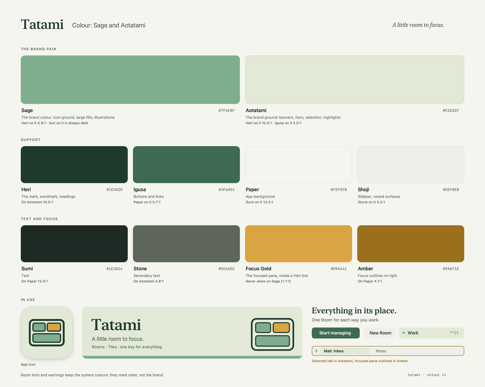

# Tatami brand

A little room to focus.

## The idea

A Japanese room is measured in tatami mats, and the mats fill it exactly: no gaps, no overlaps. Tatami does that for windows. The mark is a frame holding panes, and the pane with focus is gold.

## Colour

Sage and Aotatami lead. Heri draws the mark, Igusa acts, gold marks the focused pane. The app's values live in `Sources/Tatami/Palette.swift`.

| Name | Hex | Role | Contrast |
|---|---|---|---|
| **Sage** | `#7FAE8F` | Brand colour: plain panes in the mark, bands, illustrations | Heri on it 4.9:1 |
| **Aotatami** | `#E2EAD7` | Brand ground: icon, banners, selection | Heri on it 10.0:1 |
| Heri | `#1E3A2D` | The mark, wordmark, headings | On Aotatami 10.0:1 |
| Igusa | `#3F6A52` | Buttons and links | Paper on it 5.7:1 |
| Paper | `#F5F5F0` | App background | Sumi on it 13.5:1 |
| Shoji | `#EDF0E8` | Sidebar, raised surfaces | Stone on it 5.2:1 |
| Sumi | `#1E2B24` | Text | On Paper 13.5:1 |
| Stone | `#5E665C` | Secondary text | On Aotatami 4.8:1 |
| Focus Gold | `#D9A441` | The focused pane | On Heri 5.5:1 |
| Amber | `#9A6F1E` | Focus outlines on light surfaces | On Paper 4.1:1 |

Names come from the mat: *heri* is the cloth border, *igusa* the rush it is woven from, *aotatami* a fresh green mat, *sumi* ink, *shoji* the paper screen.

### Rules

- **Text on Sage is always dark.** White on Sage is 2.5:1.
- **Gold always sits inside a Heri line.** Gold and Sage are nearly the same brightness (1.1:1), and gold on a light ground is 1.9:1, so the outline is what makes it read.
- **Never gold text on a light ground.** Use Amber for focus lines there.
- **Panels that float over other apps follow the system appearance.** Tab bars and the Room bar use `Palette.focus` (Amber on light, Focus Gold on dark), `Palette.active` (Igusa on light, Sage on dark) and `Palette.selection` (Aotatami on light).
- **Room tints and warnings keep the system colours.** They mark state, not the brand.

## Wordmark and voice

- The name is written **Tatami**, capitalised, in the serif (New York) for display and the system sans everywhere else.
- One line carries the brand: **A little room to focus.** Describe the product as *keyboard first window management for macOS*.

## Assets

| Asset | Source | Rebuild |
|---|---|---|
| App icon | `docs/icons/10-aotatami.svg` | `swift scripts/make_icon.swift` writes `Resources/AppIcon.icns` |
| Menu bar mark | `Sources/Tatami/BrandMark.swift` (geometry in `docs/icons/menubar-template.svg`) | Drawn at runtime as a template image, tinted by macOS |
| README banner | `docs/images/hero.svg` | Edit the SVG |

The other files in `docs/icons` are earlier concepts, kept for reference.
